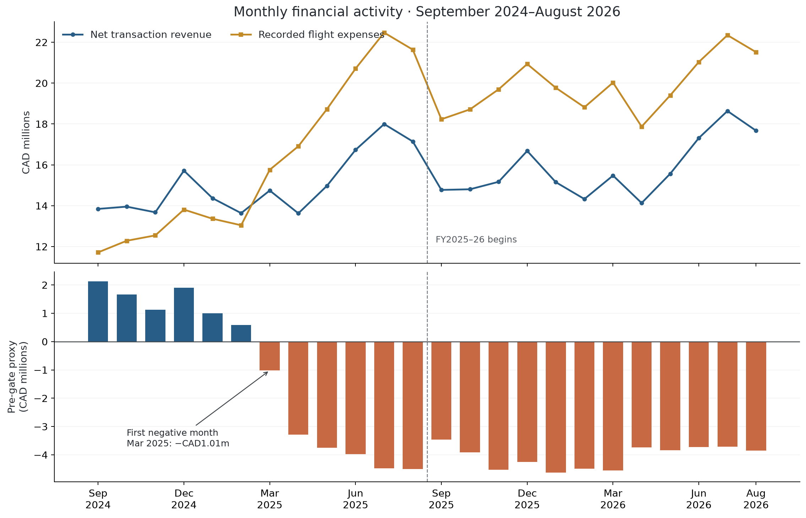
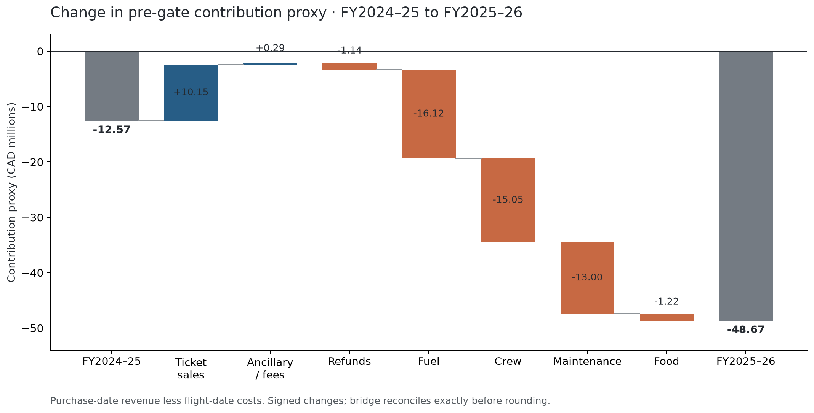
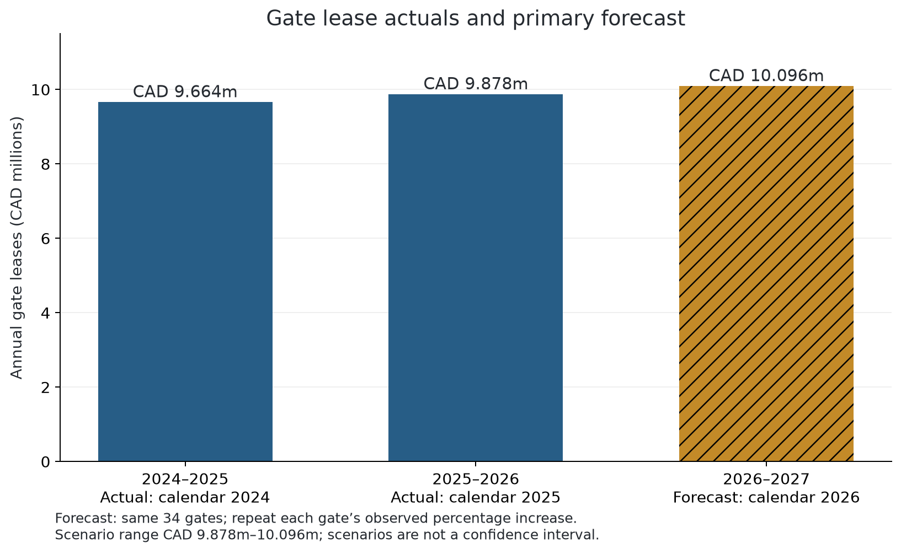

# FirstByte 2026 — Final Analysis Report

## Executive Summary

NorthByte's larger operation generated more receipts but much faster expense growth. Net transaction revenue increased **5.15% to CAD189.71m**, while recorded flight expenses increased **23.52% to CAD238.38m**. The **pre-gate activity-period proxy fell from −CAD12.57m to −CAD48.67m**, a **CAD36.10m deterioration**. This proxy subtracts flight-date expenses from purchase/refund-date revenue; it is not matched-flight accrual operating profit. All amounts below are Canadian dollars; revenue/receipts mean recorded transaction amounts, not a reconstructed cash flow. [Financial analysis](../notebooks/01_financial_trends.ipynb), [exact annual figures](tables/01_annual_financials.csv).

| Question | Direct answer and decision implication | Evidence |
| --- | --- | --- |
| 1. Financial performance | Costs outgrew revenue; the first negative monthly proxy is **March 2025**. Review the economics of added flying before further expansion. | [Monthly results](tables/01_monthly_financials.csv), [activity](tables/01_operating_activity.csv) |
| 2. Network profitability | **26 of 54 directions** are positive, but their **CAD12.37m** surplus covers only **20.3%** of **CAD61.04m** in route losses. Four corridors account for **71.2%** of deterioration. Review these corridors before making broad network cuts. | [Route pools](tables/02_cross_subsidy_pools.csv), [corridor review](tables/06_corridor_review.csv) |
| 3. Loss drivers | Fuel, crew and increased refunds contribute **CAD32.31m, or 89.51%**, of the decline arithmetically. Rewards cost is unidentifiable. Prioritize operating economics while investigating the causes. | [Exact bridge](tables/03_decline_bridge.csv), [Rewards observations](tables/03_rewards_payment.csv) |
| 4. Revenue composition | FY2 ancillaries add **CAD3.96m**, versus **CAD7.82m** of refunds. Inferred connection-compatible bookings supply **CAD13.08m / 6.90%** of net receipts, with no proven incremental margin. Small commercial improvements help but cannot close the gap. | [Revenue composition](tables/04_revenue_bridge.csv), [booking proxy](tables/04_connecting_booking_proxy.csv) |
| 5. Gate economics | Calendar-year lease costs rose **2.21% to CAD9.878m**. Budget **CAD10.096m** for missing calendar-2026 contracts under the primary escalation scenario. Two unassigned gates warrant review, with no assured savings. | [Actual leases](tables/05_lease_year_totals.csv), [forecast scenarios](tables/05_forecast_scenarios.csv), [unassigned leases](tables/05_unassigned_gate_leases.csv) |
| 6. Recommendations | Start with corridor, fuel/crew and maintenance reviews; pilot disruption prevention, gate consolidation and clear optional ancillaries. Build matched-flight and Rewards evidence before permanent changes. A hypothetical **3% fuel/crew improvement still leaves CAD43.93m negative** before project costs. | [Action register](tables/06_prioritized_actions.csv), [sensitivities](tables/06_financial_sensitivities.csv) |

The case narrative's approximately CAD40m FY2 loss and February 2025 onset are not reproduced by the supplied records under the requested date assumption: measured results are **CAD48.67m negative before gates** and a **March** onset. The report retains that discrepancy rather than adjusting the data to fit it. [Question 1 conclusions and sensitivity](../notebooks/01_financial_trends.ipynb).

## Question 1 — Financial Performance

**Original question:** “How did revenue, costs and profit change between FY2024–25 and FY2025–26? When did performance deteriorate, and why?” [Project questions](../REAME.md#questions-to-answer).

**Direct answer:** Net revenue grew, but the increase in recorded flight costs was almost five times as large in dollars. The pre-gate proxy loss widened **CAD36,099,983.54**; its margin worsened from **−6.96% to −25.65%**. The monthly proxy first became negative in **March 2025**, remaining negative through August 2026. [Notebook 01](../notebooks/01_financial_trends.ipynb), [annual change](tables/01_annual_change.csv), [monthly results](tables/01_monthly_financials.csv).

| Observed-period measure | FY2024–25 | FY2025–26 | Change |
| --- | ---: | ---: | ---: |
| Net transaction revenue | 180,419,443.08 | 189,710,371.80 | +9,290,928.72 / +5.15% |
| Recorded flight expenses | 192,985,563.99 | 238,376,476.25 | +45,390,912.26 / +23.52% |
| Pre-gate activity-period proxy | −12,566,120.91 | −48,666,104.45 | −36,099,983.54 |
| Observed departures | 13,072 | 15,729 | +20.33% |
| Average recorded expense per departure | 14,763.28 | 15,155.22 | +2.65% |

Sources: [annual financials](tables/01_annual_financials.csv), [annual change](tables/01_annual_change.csv), [operating activity](tables/01_operating_activity.csv). Fiscal years run September 1–August 31. Departures are validated route/timestamp groups with one row for each of the four expense categories, not measures of seat capacity or passengers.

February 2025 still contributes **+CAD592,799.55**; March is **−CAD1,014,626.60**. Recorded departures increase from **792 to 1,157** between those months. That timing is consistent with investigating the spring expansion, but does not establish its causal effect. [Monthly results](tables/01_monthly_financials.csv), [flight activity](figures/01_flight_activity.png).

The expense increase separates arithmetically into **CAD39.23m** from extra departures valued at the first year's average expense and **CAD6.16m** from changes in average expense, including route and seasonal mix. This is a descriptive identity, not a measure of waste or isolated input-price inflation. Revenue and expense clocks differ, so slower ticket-transaction growth cannot establish lower load factors. [Expense decomposition](tables/01_expense_volume_average_decomposition.csv), [method and limits](../notebooks/01_financial_trends.ipynb).

**Business implication:** investigate the incremental receipts and avoidable cost of added frequencies alongside unit economics. Revenue growth alone is insufficient evidence to justify expansion; matched departure revenue and capacity data are needed before quantifying its return.

## Question 2 — Network Profitability

**Original question:** “Which routes, airports or network segments are profitable or loss-making? Are profitable operations subsidizing others?” [Project questions](../REAME.md#questions-to-answer).

**Direct answer:** Performance varies sharply within the network. Profitable routes offset part of the loss elsewhere, but their cushion shrank as the negative pool expanded. All route, airport and segment results here are **pre-gate contribution proxies**, not fully loaded or avoidable-profit estimates. [Notebook 02](../notebooks/02_network_profitability.ipynb).

| Route pool | FY2024–25 | FY2025–26 |
| --- | ---: | ---: |
| Positive directional routes | 30 / 54 | 26 / 54 |
| Positive contribution | CAD14.87m | CAD12.37m |
| Negative directional routes | 24 / 54 | 28 / 54 |
| Gross loss pool | CAD27.44m | CAD61.04m |
| Gross losses covered by positive routes | 54.2% | 20.3% |

Source: [cross-subsidy pools](tables/02_cross_subsidy_pools.csv). Pool membership is determined separately each year; this illustrates financial offset rather than tracing cash transfers.

Toronto→Calgary is the strongest FY2 direction at **+CAD1,489,304.01**. Calgary→Vancouver and Vancouver→Calgary contribute **+CAD1,236,277.53** and **+CAD1,219,640.04**. Montreal→Vancouver loses **CAD10,313,210.33**, and Vancouver→Montreal loses **CAD9,409,776.57**. Their two-way loss is **CAD19,722,986.90**, or **32.3% of the gross loss pool**. [Directional route results](tables/02_directional_route_profitability.csv), [two-way corridors](tables/02_two_way_corridors.csv).

The eight directions in **Montreal↔Vancouver, Halifax↔Toronto, Montreal↔Toronto and Ottawa↔Toronto** account for **CAD25,687,713.86 / 71.2%** of the decline. All eight were already negative in FY1, making deepening established losses the leading review priority. [Corridor review](tables/06_corridor_review.csv), [directional changes](tables/02_directional_route_changes.csv).

Departure portfolios are positive at **8 of 20 airports**: Calgary, Kelowna, Edmonton, Winnipeg, Regina, Saskatoon, Quebec City and Victoria. Calgary leads at **+CAD3.55m**; Montreal (**−CAD18.47m**), Toronto (**−CAD11.10m**), Halifax (**−CAD8.48m**), Vancouver (**−CAD6.45m**) and Ottawa (**−CAD5.66m**) have the largest negatives. Assigning every route to its departure airport once avoids double-counting arrivals. [Airport results](tables/02_departure_airport_profitability.csv).

| FY2025–26 network segment | Contribution proxy |
| --- | ---: |
| Hub→hub | −CAD21.34m |
| Hub→non-hub | −CAD11.13m |
| Non-hub→hub | −CAD12.89m |
| Non-hub→non-hub | −CAD3.30m |

Source: [network segments](tables/02_network_segments.csv). Hubs are Vancouver, Calgary, Toronto and Montreal. Each hub-related group still contains positive directions; all six non-hub→non-hub directions are negative.

**Business implication:** prioritize the four deteriorating corridors and retain route-level distinctions within airports and broad segments. A route's recorded loss is not its closure saving: fixed commitments, lost receipts and feeder effects could persist or offset any avoided cost. The inferred connection evidence in Question 4 reinforces the need for network-level evaluation before withdrawal.

## Question 3 — Loss Drivers

**Original question:** “How much of the decline is explained by fuel and crew costs, refunds and the NorthByte Rewards program? Which matter most?” [Project questions](../REAME.md#questions-to-answer).

**Direct answer:** Fuel and crew dominate the measured drivers; increased refunds are smaller. Combined, these adverse movements total **CAD32,313,439.50**, or **89.51% of the CAD36,099,983.54 net deterioration**. Rewards' cost contribution cannot be quantified from the supplied fields. [Notebook 03](../notebooks/03_loss_drivers.ipynb), [exact decline bridge](tables/03_decline_bridge.csv).

| Driver | Effect on the FY2 versus FY1 proxy | Share of net decline |
| --- | ---: | ---: |
| Higher fuel expense | −16,121,247.14 | 44.66% |
| Higher crew expense | −15,049,420.86 | 41.69% |
| Higher refund outflow | −1,142,771.50 | 3.17% |
| Higher maintenance expense | −13,003,356.24 | 36.02% |
| Higher food expense | −1,216,888.02 | 3.37% |
| Higher ticket receipts | +10,145,584.72 | −28.10% |
| Higher ancillary/fee receipts | +288,115.50 | −0.80% |
| **Net change** | **−36,099,983.54** | **100%** |

Source: [exact decline bridge](tables/03_decline_bridge.csv). Adverse shares exceed 100% before favorable sales growth offsets them; rounding can affect the displayed sum. Refunds are already included in net revenue and are not subtracted again.

Under the stated volume/average convention, additional flying accounts for **CAD25.77m / 82.67%** of the combined fuel/crew increase; average cost and mix account for **CAD5.40m**. Average recorded fuel expense per departure rises **3.09%**, and crew **4.05%**. The records contain no fuel quantities/prices or crew hours/wage rates, so these changes do not prove fuel inflation, wage inflation or preventable inefficiency. [Cost and volume decomposition](tables/03_cost_volume_and_average.csv).

Refund outflows rise **17.11%**, from **CAD6,678,311.69 to CAD7,821,083.19**. Refund records grow from **6,234 to 7,265**, while average refund size rises only **0.49%**. The outflow increases from **3.57% to 3.96% of positive receipts**. These are processing-period ratios, not passenger cancellation probabilities or evidence of a particular disruption cause. [Refund metrics](tables/03_refund_metrics.csv).

FY2 **Points + Cash** includes **19,050 ticket records** and **CAD19,739,857.11 of recorded ticket amounts**. These are receipt/exposure measures; the files do not identify their cash/point split, point value, redemption liability, benefits expense or incremental customer retention. Membership and payment partitions overlap and must not be added into a program-cost estimate. **Unidentified Rewards cost is not zero cost.** [Payment observations](tables/03_rewards_payment.csv), [membership observations](tables/03_rewards_membership.csv), [analysis limits](../notebooks/03_loss_drivers.ipynb).

**Business implication:** investigate schedule contribution and fuel/crew productivity first, with maintenance included because its increase is material. Analyze refund causes to protect service quality. Obtain Rewards economics before changing benefits or attributing a dollar loss to the program.

## Question 4 — Revenue Composition

**Original question:** “How do ancillary sales, refunds and connecting passengers affect earnings?” [Project questions](../REAME.md#questions-to-answer).

**Direct answer:** Ancillaries add a small, growing receipt stream, but refund outflows are roughly twice as large. Connection-compatible bookings represent material network receipts, while their true passenger connections and incremental profit remain unconfirmed. These data establish receipt composition, not product or customer profitability. [Notebook 04](../notebooks/04_revenue_analysis.ipynb).

| Receipt component | FY2024–25 | FY2025–26 |
| --- | ---: | ---: |
| Ticket receipts | 183,426,906.51 | 193,572,491.23 |
| Ancillary/fee receipts | 3,670,848.26 | 3,958,963.76 |
| Gross positive receipts | 187,097,754.77 | 197,531,454.99 |
| Refund outflow, subtracted once | 6,678,311.69 | 7,821,083.19 |
| **Net transaction revenue** | **180,419,443.08** | **189,710,371.80** |

Source: [revenue bridge](tables/04_revenue_bridge.csv). Ancillaries include Extra Baggage, Seat Upgrade, Food & Onboard and Change Fee; their servicing and distribution costs are not isolated.

Ancillaries grow **7.85%** and supply **2.00% of FY2 gross receipts**; baggage contributes **53.94% of ancillary receipts**. Refunds remove **3.96% of gross receipts** and exceed ancillary receipts by **CAD3,862,119.43**. The difference describes receipt scale, not a suggestion that every refund is avoidable. [Ancillary categories](tables/04_ancillary_categories.csv), [revenue bridge](tables/04_revenue_bridge.csv).

The inferred connection-compatible class contains **6,658 FY2 bookings** and **CAD13,082,465.88 / 6.90% of net receipts**. It requires two ticket routes that form a continuous nonreciprocal chain, using all supplied tickets to classify the booking. Reciprocal returns and disconnected pairs are separate. Purchase timestamps and route continuity cannot prove an actual itinerary, travel date or connection. Its **CAD1,964.92 per booking**, versus **CAD989.69** for the one-ticket class, partly reflects two tickets and does not establish superior passenger yield or profit. [Booking classes](tables/04_connecting_booking_proxy.csv), [classification sensitivity](tables/04_connection_sensitivity.csv), [method](../notebooks/04_revenue_analysis.ipynb).

Direct Web and Mobile App together supply **62.07% of FY2 net receipts** and **CAD2,458,562.69 of ancillary receipts**. Their scale supports an experiment; absent channel costs, it does not prove superior margin. A hypothetical 10% ancillary uplift is **CAD245,856.27** on direct channels or **CAD395,896.38** network-wide. Combining a 10% network ancillary uplift with a 10% reduction in refund outflow retains **CAD1,178,004.70**, only **2.42% of the pre-gate deficit**, before implementation and servicing costs. These are assumptions, not achievable targets. [Channel evidence](tables/04_booking_channel.csv), [growth sensitivities](tables/04_growth_sensitivities.csv), [direct/network scenarios](tables/06_financial_sensitivities.csv).

**Business implication:** test clear optional offers and reduce preventable disruptions while honoring legitimate refunds. Protect verified feeder demand when evaluating routes. Ancillaries and refund improvements can supplement a turnaround but cannot plausibly be presented as a complete solution on these sensitivities.

## Question 5 — Gate Economics

**Original question:** “How did gate costs change between lease years, and what should NorthByte expect to pay in 2026–2027?” [Project questions](../REAME.md#questions-to-answer).

**Direct answer:** The unchanged **34-gate / 20-airport** portfolio rose from **CAD9,664,400.00 in calendar 2024** to **CAD9,877,700.00 in calendar 2025**, up **CAD213,300.00 / 2.21%**. Repeating each gate's observed percentage increase produces a primary **calendar-2026 forecast of CAD10,095,844.04**. The case's “2026–2027” lease year means **January 1, 2026 to January 1, 2027**, end exclusive. It is not a fiscal-year forecast. [Notebook 05](../notebooks/05_gate_costs.ipynb), [lease totals](tables/05_lease_year_totals.csv), [gate-level forecast](tables/05_gate_change_forecast.csv).

| Calendar-2026 scenario, unchanged portfolio | Annual lease estimate |
| --- | ---: |
| Flat calendar-2025 rates | 9,877,700.00 |
| Repeat each gate's dollar increase | 10,091,000.00 |
| Repeat the portfolio percentage increase | 10,095,707.68 |
| **Repeat each gate's percentage increase — primary** | **10,095,844.04** |

Source: [forecast scenarios](tables/05_forecast_scenarios.csv). Only one annual change is observed. The **CAD9.878m–10.096m scenario span is not a confidence interval**, a contract quote or a guaranteed spending range; renegotiations and portfolio changes can move actual expense outside it.

Each lease is counted once per airport/gate/year, despite repeated route-assignment rows. Summing those rows would overstate the latest actual annual bill by **CAD7,941,900**. All gate rates rise; Vancouver, Calgary, Toronto and Montreal together account for **67.37% of the increase**. [Lease reconciliation](tables/05_lease_year_totals.csv), [airport changes](tables/05_airport_change_forecast.csv).

**Halifax A3 and Ottawa A2** have no assigned routes in either observed year. They cost **CAD433,500.00 in calendar 2025** and carry **CAD441,444.87 in the calendar-2026 forecast**. Unassigned does not prove physically unused: contingency needs, occupancy, lease exit rights, replacement handling and community connections must be checked. The forecast amount is a conditional **annual gross ceiling**, not assured savings or a FY2 cost reduction. [Unassigned gates](tables/05_unassigned_gate_leases.csv), [gate forecasts](tables/05_gate_change_forecast.csv).

For route analysis, follow the case rule: divide each airport's **total** gate bill across **all departing flights**, then aggregate to routes, with no arrival charge. Assigned and unassigned pools are disclosed separately and charged once. Uniform monthly accrual gives estimated gate expense of **CAD9,806,600.00 in FY1** and **CAD10,023,129.36 in FY2**; the latter includes eight forecast months. Allocations reconcile to the airport and network totals. [Fiscal allocation summary](tables/05_fiscal_allocation_summary.csv), [route allocations](tables/05_route_fiscal_gate_allocations.csv), [airport allocations](tables/05_airport_fiscal_usage_allocation.csv).

Adding this estimated FY2 gate layer once to the pre-gate proxy yields a **conditional −CAD58,689,233.81**, not measured accrual operating profit. Estimated gate cost per departure falls from **CAD750.20 to CAD637.24** as flight counts rise, illustrating fixed-cost spreading without proving spare capacity or congestion. [Conditional financial context](tables/06_financial_context.csv), [fiscal summary](tables/05_fiscal_allocation_summary.csv).

**Business implication:** reconstruct the missing contracts, plan around CAD10.10m under the stated scenario and investigate gate sharing or consolidation where operationally feasible. Avoid claiming savings from allocated overhead alone.

## Question 6 — Business Recommendations

**Original question:** “What short- and long-term actions should NorthByte take, and how will they affect customers, employees and communities?” [Project questions](../REAME.md#questions-to-answer).

**Direct answer:** Prioritize the economics of flying, then reliability and smaller commercial/fixed-overhead opportunities. Start reversible pilots and data reconciliation now; make permanent network, staffing, lease and Rewards decisions only after demonstrating incremental network contribution and feasible service transitions. The timing and owners below are **proposed management actions**, not observed results or commitments. [Notebook 06](../notebooks/06_recommendations.ipynb), [prioritized actions](tables/06_prioritized_actions.csv), [implementation roadmap](tables/06_implementation_roadmap.csv).

1. **Review the four deteriorating corridors and fuel/crew economics first.** In days 0–90, the CFO/COO should pause discretionary net expansion while matching flown revenue, passengers, seats, fuel use, crew hours and avoidable costs on Montreal↔Vancouver, Halifax↔Toronto, Montreal↔Toronto and Ottawa↔Toronto. Test retiming, frequency consolidation and aircraft fit with safe rosters before withdrawal. These corridors explain **71.2% of deterioration**, and FY2 fuel/crew expense is **CAD157.95m**. In months 3–12, scale only improvements that remain positive after lost ticket/feeder receipts, maintenance, transition and contractual costs. Recorded route losses cannot be booked as closure savings. [Corridors](tables/06_corridor_review.csv), [cost exposure and scenarios](tables/06_financial_sensitivities.csv).

2. **Audit maintenance purchasing and planning without deferring required work.** Engineering and finance should review invoices, parts terms, aircraft/route mix and planned versus unplanned work in the first 60 days. The **CAD13.00m increase** and **CAD71.39m FY2 base** justify investigation, not an assertion of waste. In months 3–12, scale verified purchasing or planning improvements only while preserving airworthiness, dispatch reliability and workforce capability. No blanket maintenance cut is supported. [Cost evidence](tables/03_cost_volume_and_average.csv), [action conditions](tables/06_prioritized_actions.csv).

3. **Prevent avoidable disruption, preserving valid refunds.** Over days 0–90, customer and operations teams should link refunds to original tickets and disruption reasons, then pilot resilience improvements where preventable causes are demonstrated. In months 3–12, fund recovery resources only where retained network contribution exceeds their full cost. Lower outflow must come from fewer qualifying disruptions, never denial or delay of eligible refunds. Cause-linked data are missing, so a precise achievable improvement cannot be forecast. [Refund evidence](tables/03_refund_metrics.csv), [roadmap](tables/06_implementation_roadmap.csv).

4. **Recover contracts and review the two unassigned gates.** Start contract recovery immediately; in days 30–90, station teams should verify peak and contingency use, accessibility, sharing and termination rights for Halifax A3 and Ottawa A2. Pursue feasible sharing or release at the next contractual opportunity. Their **CAD441,444.87 forecast annual exposure** is only a ceiling before penalties, replacement handling and service effects. Less gate capacity can reduce flexibility and increase staff workload. [Unassigned gates](tables/05_unassigned_gate_leases.csv), [forecast exposure](tables/05_gate_change_forecast.csv).

5. **Test transparent optional ancillaries in direct channels.** In days 30–90, use a control group for clear baggage/seat offers and measure contribution after servicing, acquisition, technology, fare cannibalization and conversion effects. Direct channels supply **62.07% of FY2 net receipts**, but their relevant ancillary base is only **CAD2.46m**. In months 3–12, scale net-positive offers with acceptable complaints and accessibility; train front-line employees and retain usable nondigital booking support. Avoid mandatory-fee or refund restrictions that undermine customer treatment. [Channels](tables/04_booking_channel.csv), [direct-only scenario](tables/06_financial_sensitivities.csv).

6. **Build the evidence foundation now; redesign network and Rewards over the longer term.** In days 0–30, finance/data teams should join bookings to flown legs, retain date exclusions and obtain occupancy, disruption, fuel, crew and Rewards cost/liability records. Over months 3–18, verify feeder itineraries and assess regional links on total network contribution and access needs; evaluate Rewards on incremental retained contribution after benefits and administration cost. Honor accrued benefits, consult affected employees/communities, and evaluate training, redeployment and workable travel alternatives before permanent changes. Fleet investment, financing requirements and a break-even date cannot be justified from these files. [Evidence gaps and release conditions](../notebooks/06_recommendations.ipynb), [stakeholder tradeoffs](tables/06_stakeholder_tradeoffs.csv).

The following **mechanical sensitivities** communicate scale. Their selected rates are assumptions, their benefits are gross before project costs, and none is an achievable savings forecast.

| Separate sensitivity | Gross change | Remaining FY2 pre-gate deficit |
| --- | ---: | ---: |
| 3% lower fuel/crew cost, unchanged flying and receipts | 4,738,484.42 | 43,927,620.03 |
| 1% lower maintenance cost, required work preserved | 713,874.80 | 47,952,229.65 |
| 10% lower refund outflow through fewer disruptions | 782,108.32 | 47,883,996.13 |
| 10% higher network ancillary receipts | 395,896.38 | 48,270,208.07 |
| 10% higher direct-channel ancillary receipts | 245,856.27 | 48,420,248.18 |
| Combined 10% network ancillary/refund sensitivity | 1,178,004.70 | 47,488,099.75 |
| Both unassigned gate leases disappear without replacement | 441,444.87 calendar-2026 ceiling | Not comparable to FY2 residual |

Source: [financial sensitivities](tables/06_financial_sensitivities.csv). **Do not sum these rows:** direct ancillaries are a subset of network ancillaries; the combined receipt row includes its component scenarios; schedule, maintenance, crew and reliability actions can overlap. The gate ceiling uses a different calendar period and depends on unverified lease-release feasibility.

| Stakeholder | Intended benefit | Main tradeoff and proposed release conditions |
| --- | --- | --- |
| Customers | More reliable travel, clear optional prices, honored refunds and Rewards | Consolidation can reduce choice and connection quality; offers can hurt affordability/conversion. Monitor complaints, journey options, all-in prices and timely eligible refunds. |
| Employees | Better planning, safe rosters, training and redeployment | Fewer departures/gates can reduce hours or increase workload. Consult before permanent changes; monitor fatigue, overtime, safety reports and workforce transitions. |
| Communities | Preserve workable regional/northern access and hub connections | Frequency reductions may lengthen journeys or weaken access. Consult affected communities and assess practical alternatives before withdrawal. |

Source: [stakeholder register](tables/06_stakeholder_tradeoffs.csv). These monitoring measures are proposed guardrails; historical baselines and acceptable thresholds are not available in the supplied files and must be established before pilots.

## Final Conclusion

NorthByte's immediate priority is to establish and improve the incremental economics of its flight schedule. **CAD45.39m of additional recorded flight costs overwhelmed CAD9.29m of additional net receipts**, while a shrinking profitable-route pool could not offset concentrated losses. [Annual change](tables/01_annual_change.csv), [route pools](tables/02_cross_subsidy_pools.csv).

Review major weak corridors, fuel/crew productivity and maintenance planning first; use disruption, ancillary and gate pilots as supporting actions. Their disclosed sensitivities leave a large deficit and do not establish a route to break-even. Permanent decisions require matched-flight revenue, genuinely avoidable costs, validated connections, contract terms and workforce/community transition evidence. [Recommendations](../notebooks/06_recommendations.ipynb), [scenario limits](tables/06_financial_sensitivities.csv).

The evidence is **ready to share with the stated caveats**. Independent validation reran all six notebooks, recomputed consequential monetary totals and classifications from source CSVs, and reconciled financial outputs across questions. All **21 PNG figures** were visually reviewed in overview contact sheets; the monthly trends, decline bridge, gate forecast and lever sensitivities were additionally inspected individually. This visual check covers exported figures, not every notebook page in a browser. [Independent validation ledger](tables/07_validation.csv), [financial reconciliation](tables/07_financial_reconciliation.csv).

## Assumptions and Limitations

- **Period and clocks:** fiscal years run September–August. Transactions measure purchase/refund processing; costs measure flight activity. The pre-gate proxy is not matched accrual profit and excludes gates and any unrecorded overhead. The after-gate proxy is explicitly conditional on forecast/accrual assumptions. [Financial method](../notebooks/01_financial_trends.ipynb), [conditional context](tables/06_financial_context.csv).
- **Dates:** only the remaining **7,902** ambiguous transactions use the user's DD/MM/YYYY assumption. All **57 duplicate-resolved records** and already parsed timestamps are preserved. **759 rows / CAD499,209.97 net** fall outside the study period and are excluded from fiscal totals but retained in source data; **557,370 transactions** remain in scope. Reinterpreting only assumed dates as MM/DD/YYYY yields **CAD36,143,639.65 deterioration**, with the same March onset. This sensitivity is not a probability interval. [Scope reconciliation](tables/01_date_scope_reconciliation.csv), [date sensitivity](tables/01_date_assumption_sensitivity.csv).
- **Source and arithmetic:** supplied processed CSVs determine dates, standardized routes and monetary classifications; raw transaction/cost ID–amount populations and deduplicated gate amounts were independently reconciled, accounting for 1,856 repeated transaction records (CAD1,230,798.17) removed during cleaning. Money is checked in exact cents/Decimal; published CSV floating-point tails are rounded for presentation. Positive/negative route pools are defined separately each year. [Validation ledger](tables/07_validation.csv), [cross-question reconciliation](tables/07_financial_reconciliation.csv).
- **Causality and flight grain:** four distinct cost categories per route/timestamp support observed-flight counts. Decompositions describe arithmetic, not causal inflation, expansion losses, waste or avoidable savings. No seat counts, flown demand, fuel quantities/rates, crew hours/rates or aircraft-cycle data establish those mechanisms. [Flight/cost analysis](../notebooks/03_loss_drivers.ipynb).
- **Connections and Rewards:** route-continuous two-ticket bookings are a proxy, with reciprocal returns classified separately. They do not prove connecting passengers or incremental profit. Points + Cash amounts do not identify their cash/point composition or Rewards expense; program profitability remains unmeasured. [Booking method](../notebooks/04_revenue_analysis.ipynb), [Rewards limits](../notebooks/03_loss_drivers.ipynb).
- **Gates:** “2026–2027” is calendar 2026. Forecasts repeat one observed annual change on an unchanged portfolio; FY2 allocation includes eight forecast months and assumes uniform monthly accrual. Airport totals are allocated to departing flights only. Unassigned routes do not establish physical gate nonuse; contract and operating feasibility remain unknown. [Gate method and validation](../notebooks/05_gate_costs.ipynb).
- **Recommendations:** pilot timing, owners and guardrails are proposals. Sensitivity rates are assumptions, gross effects exclude implementation costs, overlapping alternatives cannot be summed, and calendar gate exposure is separate from fiscal scenarios. No achievable savings total, financing need or break-even date is established. [Recommendation evidence and limitations](../notebooks/06_recommendations.ipynb).
